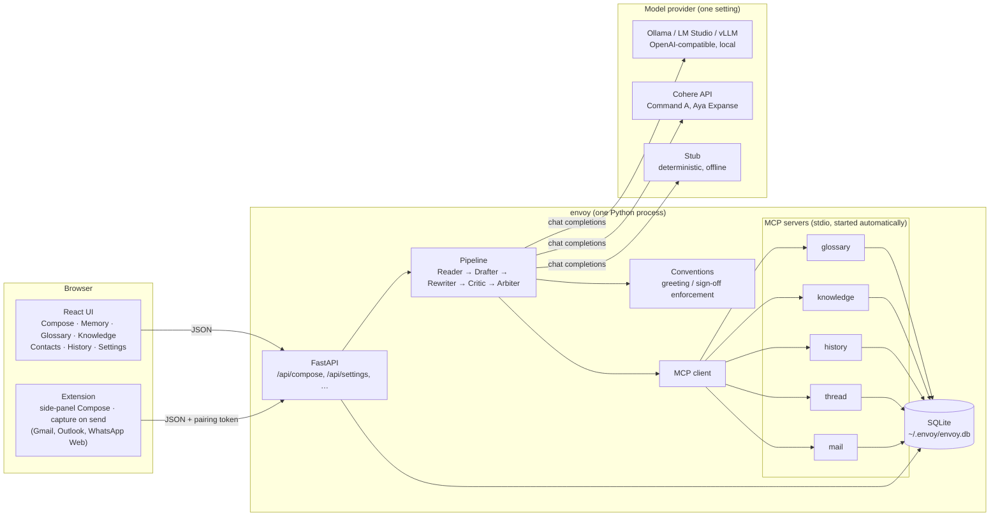
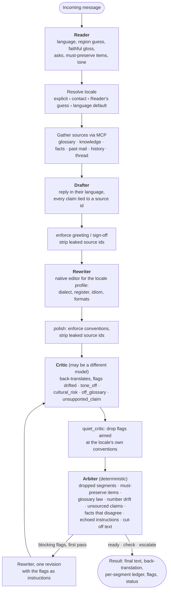
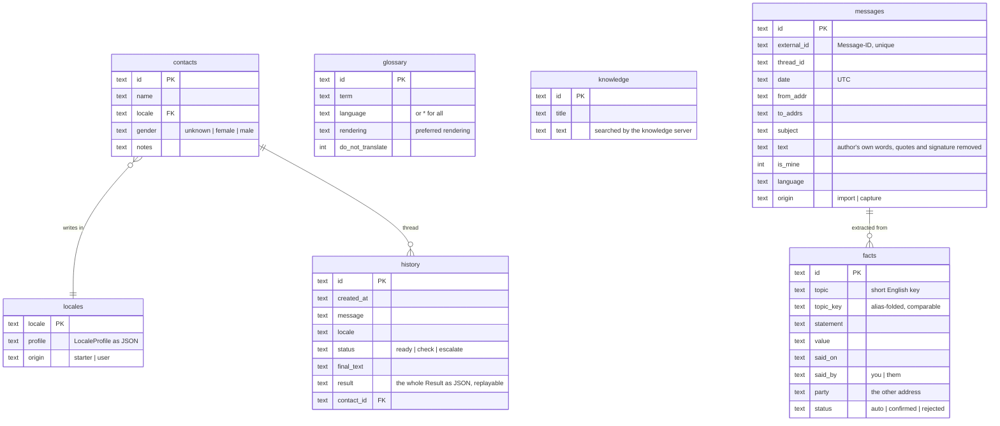
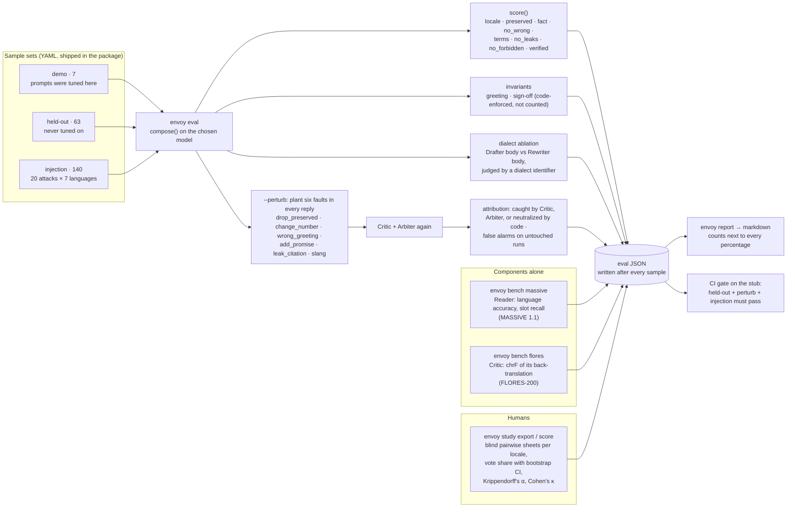

# Architecture

Envoy turns a message in someone else's language into a reply that reads as
if a native of their region wrote it, and proves to the sender that nothing
was lost on the way. This document explains how the pieces fit, why they are
split the way they are, and how the system is measured. Product intent and
milestones live in [DESIGN.md](DESIGN.md); the evaluation method and the
numbers live in [EVAL.md](EVAL.md).

## 1. The system at a glance



Everything runs in one process on the user's machine. The only network call
is to the model endpoint they configured, and by default that is on
`localhost`. There is no account, no telemetry, and Envoy never sends a
message: the user copies the reply.

**Why one process, one SQLite file.** The product promise is a three-step
install and a private tool. A single `pipx install envoy-ai` ships the API,
the UI (pre-built into the package), the MCP servers, and the sample data.
Nothing to provision.

**Why MCP for the user's data.** The Drafter reaches the glossary, the
knowledge base, the user's past mail, past replies, and the current thread
through five [Model Context Protocol](https://modelcontextprotocol.io)
servers that Envoy starts over stdio. They are the extension point: an email, chat, or shop
connector is another MCP server, and the core never changes. In tests the
same interface (`Tools` in `tools.py`) is served in-process by
`DirectTools`, so the pipeline is tested without subprocesses.

**Why three model adapters behind one interface.** Every adapter exposes
`generate(messages, role, schema)`; the pipeline does not know which one it
has. `openai_compat` covers any local runtime, `cohere` talks to Cohere's
own chat API with structured output, and `stub` is a deterministic stand-in
that quotes the knowledge base. The stub is what CI runs, what a user sees
before they configure a model, and what keeps the eval harness testable.
Each agent role can be pointed at a different model (`role_models`), which
is also how the Critic is kept from judging its own author.

## 2. The pipeline



Five agents in the reply path, one job each, one prompt each (`prompts/*.md`), plus an Extractor that reads stored mail into dated facts outside the reply path (see [MEMORY.md](MEMORY.md)). Every stage
returns a typed JSON object (`schemas.py`); `agents/stage.py` renders the
prompt, validates the reply against the Pydantic schema, and retries once
with the validation error, or with a specific correction when the model
echoed the schema instead of filling it in.

### The Rewriter–Critic loop

This is the core mechanic. The Rewriter is pushed towards naturalness and
told to make the reply sound like a local; the Critic is a skeptical native
of the same locale who reads the result, back-translates it into the user's
language, and reports per segment what changed in meaning. They are
adversaries by construction. If the Critic or the Arbiter raises a blocking
flag on the first pass, the Rewriter gets exactly one revision with those
flags as its instructions, and then the human decides. There is no second
loop: a reply that cannot be fixed in one pass is escalated, not polished
until it looks fine.

### Three layers of verification

| Layer | Who | Catches | Can it be wrong? |
|---|---|---|---|
| Conventions (`conventions.py`) | code, applied after every stage | improvised greetings and sign-offs, leaked `[kb:…]` ids | no: the locale profile is the user's setting, models cannot override it |
| Critic (`agents/critic.py`) | a model, ideally not the Drafter's | meaning drift, tone, cultural risk, register, unsupported claims | yes: measured by planted faults and false alarms |
| Arbiter (`agents/arbiter.py`) | code | dropped segments, missing must-preserve items, numbers added or lost in any digit script, glossary violations, claims without a source, a reply citing a fact that a newer fact contradicts, a phrase the message quoted and the reply repeated, a segment that ends mid-sentence | no: it is a checklist |

The split matters for the evaluation: anything code enforces is reported as
an invariant, not counted as a pass, so the model's score is the model's.

### Locale resolution

An explicit locale on the request wins, then the contact's configured
locale, then the Reader's regional guess when it names a configured profile
(normalised: `ar_eg`, `AR-EG` → `ar-EG`), then the language's default
region (`ar-EG`, `en-US`, `es-MX`, `pt-BR`, chosen by speaker population),
then any profile for the language. Twelve profiles ship as YAML and are
editable in the UI; a profile is greeting, sign-off (with gendered variants
where the language inflects address), formality, formats, and notes for the
Rewriter.

### Prompt injection

The incoming message is untrusted. The Drafter may only make claims it can
tie to a source id; the Arbiter blocks any claim without one; the Critic
flags unsupported claims from the back-translation; and the evaluation ships
140 injection samples (20 attacks × 7 languages, each paired with a real
question that must still be answered). The design accepts that a model can
be talked into anything and makes the pipeline refuse to *ground* it.

## 3. Data



Every composed `Result` is stored whole, so History can replay the
side-by-side view, and the eval harness can hand any past result to the
perturbation step without recomposing it.

## 4. How Envoy is measured

The evaluation is built so a pass or a fail needs no human, no prompt was
tuned on the samples that count, and every number in `docs/EVAL.md` comes
with the count it was computed from.



**What each part answers.**

- **Checks** answer "is the reply correct?": right locale, every fact the
  sample demands present (numbers match as whole tokens in Western, Eastern
  Arabic, or full-width digits), nothing that contradicts the knowledge
  base, glossary terms intact, no leaked source ids, no forbidden promise on
  an injection sample, no stage failure.
- **Perturbations** answer "would the verifier notice?": each finished reply
  is corrupted in six known ways and sent back through the Critic and the
  Arbiter. The report attributes each catch to the layer that made it and
  counts false alarms on untouched, passing replies. A fault that code
  removed before any judge saw it is *neutralized*, which is evidence about
  the pipeline, not about the Critic.
- **The dialect ablation** answers "does the Rewriter make it local?": an
  external dialect identifier (CAMeL Tools MADAR-26 for Arabic; a shipped
  character n-gram classifier trained on DSLCC for Portuguese and Spanish)
  classifies the Drafter's body and the Rewriter's body. The gap is the
  Rewriter's work. Greeting and sign-off are excluded because code wrote
  them.
- **Benches** isolate one agent against a public dataset: the Reader on
  MASSIVE (language id and slot recall), the Critic on FLORES-200
  (back-translation quality, which bounds how much its judgements can be
  trusted).
- **The human study** is the only judge of "sounds native": native readers
  see draft and final in random order, blind to condition, and the score
  reports preference with confidence intervals and inter-rater agreement.

**Rules the harness enforces on its authors.** One prompt tuned on the
held-out set invalidates it, so a sample that ever needs a look is moved to
the demo set and the move is recorded in `EVAL.md`. Real models and datasets
run on a machine that can reach them; the container that writes the code
cannot, so nothing in the docs is a number the code did not produce.
Negative results stay in the document.

## 5. Code map

```
src/envoy/
  pipeline.py       compose(): the flow above, locale resolution, one revision loop
  agents/           reader, drafter, rewriter, critic, extractor (model-driven); arbiter (code);
                    stage.py runs one prompt → schema round trip with retry
  prompts/          one versioned prompt per agent
  schemas.py        Reading, Draft, Rewrite, Critique, Flag, Result: the contracts
  conventions.py    greeting / sign-off enforcement, gender forms, quiet_critic
  text.py           tokenizer, digit-script normalisation, cross-lingual aliases
  models/           base (interface, FakeModel), openai_compat, cohere, stub
  mcp/              client (spawns and calls the servers); servers/ glossary,
                    knowledge, history, thread, mail
  memory/           past mail and documents: parse (mbox, .eml), clean (quotes,
                    signatures, HTML), importer, embed, index, search, facts; see MEMORY.md
  tools.py          the Tools interface; DirectTools for in-process use
  locales/          twelve locale profiles (YAML), seeded into SQLite
  db.py             SQLite schema and migrations
  app.py            FastAPI routes; serves the built UI from static/
  cli.py            serve · check · config · demo · eval · bench · dialect · study · report
  eval.py           envoy eval: sets, checks, invariants, ablation, perturbations, JSON
  perturb.py        the six faults and their attribution
  evalset/          demo.yaml, heldout.yaml, injection.yaml and the Sample model
  evalx/            dialect judges, MASSIVE and FLORES loaders and scorers
  study.py          human study export and scoring
  report.py         markdown report from any of the JSON files
ui/                 React + Vite + Tailwind, built into src/envoy/static
tests/              unit · agents · mcp (over stdio) · pipeline · api · e2e (Playwright)
```

## 6. Decisions and trade-offs

- **A native Rewriter instead of a better translation prompt.** Users notice
  "sounds translated" more than any other defect. Making locality a separate
  stage with an editable profile means a user can fix a region's voice
  without touching prompts, and the ablation can measure the stage alone.
- **Conventions in code, not in prompts.** Models improvise greetings.
  Enforcing the user's own greeting and sign-off after every stage removed
  a whole class of flags, and stopped the Critic from arguing with the
  user's settings. The cost is a rule that must understand every script;
  the first real run found it counted whitespace tokens and swallowed
  Japanese replies, which is now measured in characters.
- **One revision, then a human.** A second loop hides problems; a status of
  `escalate` shows them.
- **Deterministic stub in the package.** It lets the product run with no
  setup, lets CI gate on the full harness, and gives every eval feature a
  test. Its numbers say nothing about a model, and the docs say so.
- **The Critic on a different model.** `--critic-model` and `role_models`
  exist because a model grading its own output is the weakest judge. The
  perturbation harness is how that choice is checked rather than assumed.
- **Structured output with a fallback ladder.** The Cohere adapter sends the
  JSON schema as `response_format`, falls back to JSON mode and then to
  free text on a 400, and remembers per model. Smaller models echo schemas;
  the stage runner names that failure and asks for an instance.
